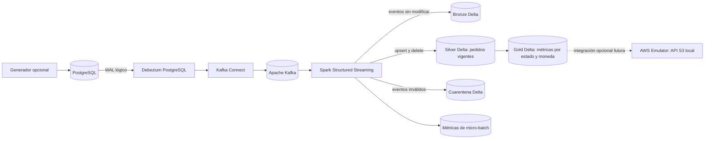

# Pulso de pedidos

Pipeline de ingeniería de datos para capturar cambios de pedidos desde PostgreSQL, transportarlos como eventos CDC y procesarlos en streaming para producir datos analíticos actualizados.

El pipeline principal se desarrolla **localmente y sin costos de nube**. AWS Emulator queda como una práctica local opcional de APIs: no reemplaza PostgreSQL, Kafka ni Spark, y no se presentará como una implementación desplegada en AWS. En Windows requiere construir una imagen Docker local; se documenta por separado y no es un prerrequisito para ejecutar el pipeline.

## Objetivo

Construir un flujo demostrable de punta a punta que permita observar cómo inserciones, actualizaciones y eliminaciones en una base transaccional se convierten en eventos, se procesan con tolerancia a reinicios y llegan a salidas analíticas.

## Arquitectura



## Tecnologías

- PostgreSQL: sistema transaccional de origen.
- Debezium y Kafka Connect: captura de cambios del log de PostgreSQL.
- Apache Kafka: broker de eventos y tecnología directamente solicitada en vacantes de streaming.
- Apache Spark Structured Streaming: procesamiento de eventos en micro-lotes.
- Delta Lake: tablas transaccionales locales para historial, estado actual y métricas.
- Docker Compose: entorno reproducible para desarrollo local.
- AWS Emulator: prueba local de S3 con Boto3 implementada y verificada; es opcional e independiente del pipeline principal.

## Estado

**Pipeline local CDC y streaming verificado de punta a punta.** PostgreSQL, Debezium, Kafka y Spark procesaron el snapshot inicial y cambios posteriores de inserción, actualización y eliminación. Se validaron Bronze, Silver, Gold, métricas por batch y el checkpoint de Spark; el reporte final mostró el pedido actualizado, el eliminado ausente y los pedidos insertados agregados por estado. También se reinició Kafka Connect: Debezium retomó el LSN guardado y omitió el snapshot ya completado. La prueba S3 opcional de AWS Emulator pasó con Boto3 para crear bucket, escribir, leer, listar y eliminar recursos. No hubo eventos en cuarentena. Consulta la [guía para explicar y ejecutar el proyecto](docs/guia-explicacion-proyecto.md), además de [`docs/architecture.md`](docs/architecture.md), [`docs/data-contract.md`](docs/data-contract.md), [`docs/roadmap.md`](docs/roadmap.md) y [`docs/decisions/`](docs/decisions/).

## Alcance inicial

El MVP usará una entidad principal (`orders`) con cambios de estado y datos de importe. Incluirá captura de `INSERT`, `UPDATE` y `DELETE`, procesamiento reproducible tras reinicios, validaciones de calidad y métricas básicas de latencia y conteo. El alcance evita servicios cloud que puedan facturar.

## Ejecución

### Primer arranque (Windows PowerShell o CMD)

Desde la carpeta del proyecto, crea el archivo de variables opcional. Usa la variante que corresponda a tu terminal:

```powershell
if (-not (Test-Path .env)) { Copy-Item .env.example .env }
```

```bat
if not exist .env copy .env.example .env
```

Luego, desde cualquiera de las dos terminales, levanta los servicios:

```text
docker compose up -d
docker compose ps
```

Si `copy` pregunta si quieres sobrescribir un `.env` existente, responde `N` para conservarlo. El archivo trae valores didácticos exclusivos para este entorno local. Si no se crea, Compose usa los valores predeterminados locales definidos en el YAML.

Cuando PostgreSQL y Kafka aparezcan como saludables y Kafka Connect responda, crea el tópico y registra el conector:

```text
curl.exe -sS http://localhost:8083/connectors
docker compose exec kafka /opt/kafka/bin/kafka-topics.sh --create --if-not-exists --topic orders.public.orders --partitions 1 --replication-factor 1 --bootstrap-server kafka:9092
curl.exe -i -X POST -H "Content-Type: application/json" --data-binary "@connectors/orders-postgres.json" http://localhost:8083/connectors
```

Consulta el estado; tanto el conector como su tarea deben mostrar `RUNNING`:

```text
curl.exe -sS http://localhost:8083/connectors/orders-postgres-connector/status
```

Después de comprobar que el conector esté `RUNNING`, inicia Spark en otra ventana de PowerShell o CMD:

```bat
docker compose --profile processor run --rm spark
```

Mientras Spark esté activo, genera cambios desde otra ventana de PowerShell o CMD:

```bat
docker compose exec postgres psql -U orders_admin -d orders_source -c "UPDATE public.orders SET status = 'SHIPPED' WHERE order_id = 1;"
docker compose exec postgres psql -U orders_admin -d orders_source -c "INSERT INTO public.orders (customer_id, status, amount_cents, currency) VALUES (104, 'PENDING', 6450, 'USD');"
docker compose exec postgres psql -U orders_admin -d orders_source -c "DELETE FROM public.orders WHERE order_id = 2;"
```

También puedes usar el generador incluido en Compose para producir `INSERT`, `UPDATE` y `DELETE` continuamente, sin instalar dependencias en Windows. Inícialo en otra ventana y detenlo con Ctrl+C:

```bat
docker compose --profile demo run --rm demo-generator
```

Cuando detengas Spark con Ctrl+C, consulta Silver, Gold, métricas y cuarentena:

```bat
docker compose --profile processor run --rm spark-report
```

La primera inicialización crea el esquema y tres pedidos de ejemplo. Los scripts de inicialización de PostgreSQL solo se ejecutan cuando el volumen de datos está vacío. **No elimines volúmenes con datos que quieras conservar.** No guardes `.env` ni credenciales reales en Git. Esta configuración y sus credenciales son únicamente para desarrollo local.

Spark guarda las dependencias Maven en `.cache/ivy`, una carpeta local ignorada por Git. Así no depende del directorio personal `/nonexistent` que trae la imagen oficial.

## Costos y AWS

El flujo principal no requiere una cuenta AWS ni recursos pagos. AWS Emulator no tiene tarifa de servicio ni requiere una cuenta AWS; la imagen se construye localmente con el paquete oficial, y la integración prevista se hará solo contra `127.0.0.1`, con telemetría desactivada y recursos efímeros. Consulta [`docs/decisions/0003-aws-emulator.md`](docs/decisions/0003-aws-emulator.md). Una futura prueba en AWS real será opcional, pequeña y precedida por una revisión de elegibilidad, límites y precios. No se afirmará que el proyecto está desplegado en AWS si solo se usó AWS Emulator.

La prueba S3 es independiente del pipeline central y tiene un perfil Compose propio. Se verificó localmente con resultado `PASS` para `CreateBucket`, `PutObject`, `GetObject`, `ListObjectsV2`, `DeleteObject` y `DeleteBucket`. Esto valida el flujo concreto usado por el proyecto contra el emulador; no garantiza paridad general con AWS. Desde PowerShell ejecútala así:

```powershell
docker compose --profile aws-emulator run --rm aws-s3-smoke
```

La primera ejecución construye localmente el emulador y el cliente de prueba. Usa un bucket único por ejecución, comprueba `CreateBucket`, `PutObject`, `GetObject`, `ListObjectsV2` y elimina los recursos de prueba. Los archivos temporales y credenciales generadas quedan en `.aws-emulator/`, carpeta ignorada por Git.

El contenedor del emulador queda activo al terminar la prueba. Deténlo cuando acabes:

```powershell
docker compose --profile aws-emulator stop aws-emulator
```
