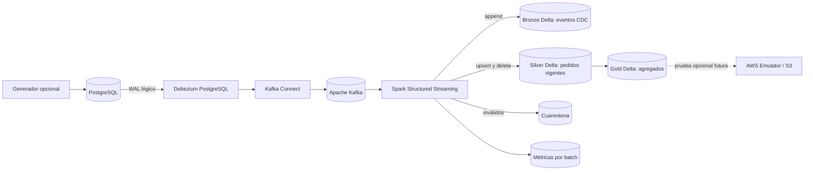

# Diseño del proyecto

## Problema que resuelve

Una aplicación de comercio electrónico actualiza pedidos en PostgreSQL. Los consumidores analíticos no deberían consultar continuamente la base operacional ni esperar una carga diaria. El pipeline captura los cambios y los hace disponibles en un flujo procesable, conservando tanto el historial de eventos como una vista analítica.

## Flujo de datos

1. Un generador inserta y modifica pedidos de prueba en PostgreSQL.
2. PostgreSQL registra las transacciones en su WAL.
3. Debezium lee el WAL mediante un conector de Kafka Connect y publica eventos CDC.
4. Apache Kafka conserva y distribuye esos eventos.
5. Spark Structured Streaming consume el tópico, interpreta el envelope de Debezium y normaliza los eventos.
6. Delta Lake conserva el historial Bronze, hace upsert/delete de pedidos vigentes en Silver y recalcula métricas Gold.
7. Los controles comparan cambios de origen con eventos procesados y reportan duplicados, eventos inválidos y retraso.

## Componentes y responsabilidades

| Componente | Responsabilidad | Ejecución inicial |
| --- | --- | --- |
| PostgreSQL | Fuente operacional y WAL | Contenedor local |
| Debezium Kafka Connect | Captura CDC y publicación | Contenedor local |
| Apache Kafka | Broker de eventos y log distribuido | Contenedor local, modo KRaft |
| Spark Structured Streaming | Parseo, calidad y transformación | Contenedor local |
| Delta Lake | Tablas locales transaccionales para Bronze, Silver, Gold y cuarentena | Sistema de archivos local |
| AWS Emulator | Pruebas locales de APIs compatibles con AWS | Etapa opcional probada para un flujo acotado de S3; aislada del pipeline principal |

## Datos del MVP

La primera entidad será `orders`: `order_id`, `customer_id`, `status`, `amount_cents`, `currency`, `created_at` y `updated_at`. El importe se guarda en centavos enteros para evitar errores de precisión decimal. Un trigger actualiza `updated_at`; `REPLICA IDENTITY FULL` conserva la imagen anterior de la fila para ilustrar actualizaciones y eliminaciones. La publicación PostgreSQL se crea explícitamente durante la inicialización y el usuario CDC recibe solo permisos de lectura y replicación. El mensaje CDC incluirá la operación (`c`, `u`, `d` o snapshot), las imágenes anterior y posterior cuando existan, la clave y metadatos de origen.

## Decisiones de diseño

- Comenzar con una entidad y un flujo vertical antes de sumar tablas relacionadas.
- Usar Apache Kafka en local con KRaft; así aprendemos el broker que forma parte explícita de la arquitectura y usamos su imagen oficial.
- Mantener AWS fuera del camino crítico: el pipeline debe funcionar sin cuenta AWS, credenciales ni red externa.
- Conservar checkpoints de Spark y diseñar explícitamente cómo se reanuda el procesamiento.
- Separar el registro de eventos CDC de las vistas de estado actual y métricas.
- Usar Delta Lake en el sink local para commits reintentables y `MERGE`; el valor diferencial se centra en CDC/streaming, no en repetir el modelado medallion anterior.
- Definir semánticas de entrega, deduplicación y recuperación según el sink que se elija; no prometer “exactly once” sin demostrarlo de extremo a extremo.
- Usar AWS Emulator solo para validar llamadas API soportadas; sus recursos en memoria no sustituyen almacenamiento duradero ni servicios administrados.

## Calidad y confiabilidad

El MVP deberá cubrir como mínimo:

- Clave de pedido presente y válida.
- Importe no negativo y estado dentro del conjunto permitido.
- Conteo de eventos recibidos, procesados y rechazados.
- Tratamiento explícito de eventos de eliminación y snapshots iniciales.
- Recuperación desde checkpoint después de detener y reiniciar el procesador.
- Manejo visible de mensajes malformados y una salida de cuarentena o dead-letter.
- Verificación de retraso entre el cambio en PostgreSQL y su disponibilidad analítica.

## Arquitectura cloud futura (opcional)

Equivalencias conceptuales posibles: PostgreSQL administrado en RDS, Kafka administrado en MSK, procesamiento Spark en EMR y almacenamiento en S3. Esta arquitectura no forma parte del MVP sin costo: MSK y EMR requieren un plan y facturación que deben revisarse antes de cualquier despliegue. La prueba S3 del proyecto usa AWS Emulator para una secuencia de APIs local; no ejecuta ni sustituye RDS, MSK, EMR o S3 administrado.

La elección de Apache Kafka y sus razones están registradas en [`decisions/0001-broker.md`](decisions/0001-broker.md). El esquema y el comportamiento de reintentos están en [`data-contract.md`](data-contract.md).
