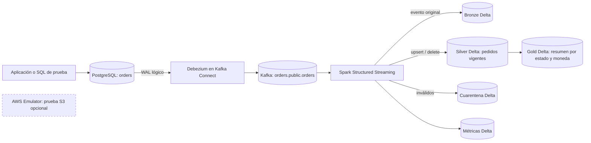

# Guía para explicar Pulso de pedidos

## Presentación breve

Pulso de pedidos es un pipeline local de ingeniería de datos que captura cambios en pedidos desde PostgreSQL, los publica como eventos CDC en Apache Kafka mediante Debezium y los procesa con Spark Structured Streaming. Delta Lake conserva el historial de eventos, el estado vigente de cada pedido, una agregación analítica y métricas de procesamiento. El entorno principal funciona con Docker Compose sin desplegar servicios en la nube. Como práctica independiente, el proyecto también prueba algunas operaciones S3 contra AWS Emulator.

## Qué problema resuelve

Una aplicación transaccional necesita modificar pedidos con rapidez. Los analistas, en cambio, necesitan consultar datos limpios y agregados sin competir con la aplicación por el acceso a PostgreSQL. El pipeline captura cada cambio desde el registro de transacciones de PostgreSQL y lo transforma en salidas analíticas que se actualizan en micro-lotes.

## Recorrido de los datos



1. **PostgreSQL** guarda `orders`, la tabla operacional con el estado más reciente de cada pedido. El WAL lógico registra las transacciones necesarias para CDC.
2. **Debezium** lee el WAL mediante un conector PostgreSQL. El primer inicio toma un snapshot; después publica los cambios en Kafka. Sus operaciones son `r` para snapshot, `c` para inserción, `u` para actualización y `d` para eliminación.
3. **Kafka Connect** ejecuta Debezium y guarda la configuración y los offsets del conector en tópicos internos de Kafka. Así puede retomar el LSN persistido tras reiniciarse.
4. **Apache Kafka** conserva los eventos en `orders.public.orders`. El tópico tiene una partición en este MVP, lo que permite comparar offsets dentro del flujo.
5. **Spark Structured Streaming** lee el tópico en micro-lotes cada cinco segundos, interpreta el JSON de Debezium y valida los campos.
6. **Delta Lake** guarda las salidas locales como tablas con historial transaccional:
   - **Bronze:** evento CDC original y metadatos de Kafka, sin perder el mensaje fuente.
   - **Silver:** una fila por pedido vigente. Inserciones y actualizaciones hacen `MERGE`; una eliminación retira el pedido.
   - **Gold:** agrupa Silver por estado y moneda y calcula cantidad de pedidos, importe total y promedio.
   - **Cuarentena:** eventos inválidos con motivo de rechazo.
   - **Métricas:** filas leídas, válidas, eliminaciones, rechazadas y retraso entre Debezium y Spark por batch.

La prueba S3 de AWS Emulator es independiente. Comprueba una secuencia acotada de APIs con Boto3; no mueve las tablas Delta a S3 ni convierte el pipeline principal en un despliegue AWS.

## Tecnologías y por qué

| Tecnología | Papel en el proyecto | Razón de uso |
| --- | --- | --- |
| PostgreSQL 16 | Base transaccional de origen | Simula el sistema operacional donde nacen los pedidos. |
| Debezium 3.7 / Kafka Connect | Captura CDC desde el WAL | Evita consultar la base repetidamente o depender de cargas completas. |
| Apache Kafka 4.3 | Log de eventos | Desacopla el origen del procesador y conserva el flujo para consumidores. |
| Spark Structured Streaming 4.2 | Procesamiento incremental | Lee eventos continuamente por micro-lotes y permite validarlos y transformarlos con Spark SQL. |
| Delta Lake 4.4 | Tablas locales Bronze, Silver y Gold | Ofrece commits transaccionales, `MERGE` y recuperación del estado materializado. |
| Docker Compose | Entorno reproducible | Levanta los componentes con una sola configuración en un equipo local. |
| AWS Emulator 1.0.513 + Boto3 | Prueba opcional de APIs S3 | Permite practicar un flujo de SDK dirigido al emulador local, sin crear recursos AWS. |

## Cómo arrancar y ejecutar el flujo principal

Ejecuta los comandos desde PowerShell en la carpeta que contiene `docker-compose.yml`.

### 1. Levantar PostgreSQL, Kafka y Kafka Connect

Solo en la primera ejecución, crea `.env` a partir del ejemplo si todavía no existe:

```powershell
if (-not (Test-Path .env)) { Copy-Item .env.example .env }
```

Después levanta los servicios base:

```powershell
docker compose up -d
docker compose ps
```

Espera a que PostgreSQL y Kafka estén `healthy` y que Kafka Connect responda en `http://localhost:8083`.

### 2. Preparar el tópico y el conector (solo en una instalación inicial)

```powershell
docker compose exec kafka /opt/kafka/bin/kafka-topics.sh --create --if-not-exists --topic orders.public.orders --partitions 1 --replication-factor 1 --bootstrap-server kafka:9092
```

Registra el conector una vez:

```powershell
curl.exe -i -X POST -H "Content-Type: application/json" --data-binary "@connectors/orders-postgres.json" http://localhost:8083/connectors
```

Confirma con `GET http://localhost:8083/connectors/orders-postgres-connector/status` que el conector y la tarea estén `RUNNING`. Si ya se registró, consulta el estado; no repitas el `POST`.

### 3. Iniciar Spark

En una segunda ventana de PowerShell:

```powershell
docker compose --profile processor run --rm spark
```

Déjalo activo mientras llegan eventos. En una tercera ventana puedes ejecutar cambios de prueba:

```powershell
docker compose exec postgres psql -U orders_admin -d orders_source -c "UPDATE public.orders SET status = 'SHIPPED' WHERE order_id = 1;"
docker compose exec postgres psql -U orders_admin -d orders_source -c "INSERT INTO public.orders (customer_id, status, amount_cents, currency) VALUES (104, 'PENDING', 6450, 'USD');"
docker compose exec postgres psql -U orders_admin -d orders_source -c "DELETE FROM public.orders WHERE order_id = 2;"
```

Cada `INSERT` ejecutado crea un pedido nuevo con un `order_id` autogenerado. Para una demostración repetible de cambios continuos también está disponible:

```powershell
docker compose --profile demo run --rm demo-generator
```

Detén el generador con Ctrl+C. Cuando Spark haya procesado los eventos esperados, detén Spark con Ctrl+C. Luego imprime las tablas:

```powershell
docker compose --profile processor run --rm spark-report
```

Ejecuta el reporte después de detener el stream. Durante un batch, Silver puede haberse actualizado antes que Gold y las métricas.

### 4. Prueba S3 opcional

```powershell
docker compose --profile aws-emulator run --rm aws-s3-smoke
docker compose --profile aws-emulator stop aws-emulator
```

La prueba verificada terminó en `PASS` para `CreateBucket`, `PutObject`, `GetObject`, `ListObjectsV2`, `DeleteObject` y `DeleteBucket`. AWS Emulator mantiene estado temporal en memoria; la prueba no requiere cuenta AWS y no afirma paridad completa con AWS.

### 5. Detener el entorno principal

```powershell
docker compose down
```

Este comando detiene los servicios y conserva los volúmenes nombrados de PostgreSQL y Kafka, además de los archivos locales `data/` y `checkpoints/`. No uses `docker compose down -v` si quieres conservar esos datos. Para reanudar el pipeline, levanta la base y el conector, conserva esos archivos y vuelve a iniciar Spark.

## Persistencia y recuperación

- `postgres_data` conserva las filas operacionales.
- `kafka_data` conserva el log KRaft y los tópicos internos de Connect, incluidos los offsets de Debezium.
- `data/` contiene tablas Delta.
- `checkpoints/` contiene los offsets y commits de Spark Structured Streaming.

Se probó reiniciar Kafka Connect: Debezium encontró el offset del servidor `orders`, omitió el snapshot ya completado y reanudó el WAL desde el LSN guardado. El offset de `orders.public.orders` siguió en `7` tras el reinicio.

También se recuperó un batch de Spark interrumpido conservando `data/` y `checkpoints/`. Bronze, cuarentena y métricas usan identificadores de transacción Delta por batch; Silver compara offsets para evitar aplicar cambios antiguos. No se debe prometer “exactly once” global: la recuperación se diseñó y verificó en cada sink local concreto.

## Respuesta corta para una entrevista

> Construí un pipeline local de CDC para pedidos. PostgreSQL genera cambios en el WAL, Debezium los captura y Kafka los conserva. Spark Structured Streaming consume el tópico, valida cada evento y mantiene Bronze con el historial, Silver con el estado actual y Gold con métricas por estado y moneda. Usé Delta Lake para hacer `MERGE` y recuperarme de batches interrumpidos con checkpoints. Validé inserciones, actualizaciones, eliminaciones, métricas, cuarentena vacía y la reanudación del conector. El flujo principal corre en Docker local; AWS Emulator es una prueba S3 separada, no un despliegue en AWS.

## Alcance y límites

Es una demostración local de un solo nodo y una tabla. No ofrece alta disponibilidad ni rendimiento de producción. El tópico usa una partición, Spark corre localmente y AWS Emulator solo valida las llamadas S3 elegidas. Una arquitectura real en AWS requeriría revisar servicios, permisos, cuotas, límites y tarifas antes de crear recursos.
